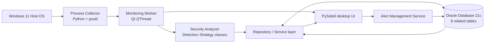
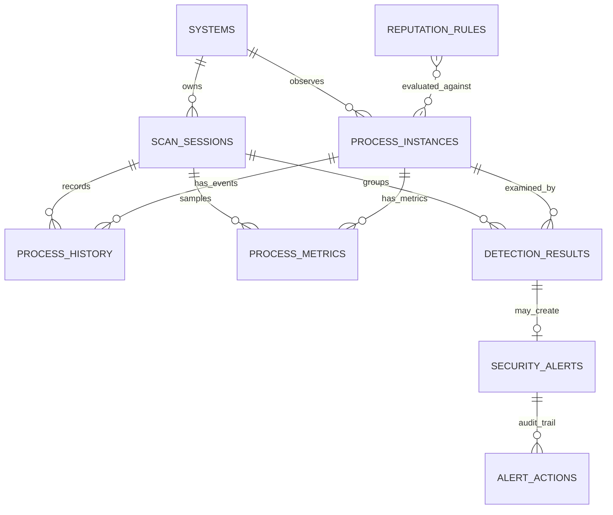

# Architecture and ER Design

## High-level architecture

The collection worker runs independently from the user interface, so file/path access, process sampling, and SQL operations do not need to run on the UI thread.

## ER diagram

`REPUTATION_RULES` is reference data and intentionally does not have a foreign key to `PROCESS_INSTANCES`; rules exist independently of a running process and are matched in application code.

## Cardinality summary

- One system may have many scan sessions and process instances.
- One session may generate many history events, metric samples, and detection results.
- One process instance may have many history events, metric samples, and detection results.
- A detection result may create at most one security alert.
- One alert may have many audit actions.
- Many process instances are evaluated against the shared reputation rules.

## Security pipeline

1. Collect a process snapshot (PID, creation time, PPID, name, executable path, state, priority, CPU, memory, thread count, and available I/O counters).
2. Match enabled reputation rules.
3. Run path verification, process spoofing, hierarchy, and resource-behavior strategies.
4. Aggregate the highest observed risk score and store evidence for each finding.
5. Create an alert only if there is no still-open alert for the same process instance and check type.
6. Let an operator record an investigation status; the action is saved to `alert_actions`.

## Low-level design principles used

- **Single responsibility:** collector gathers facts; detectors evaluate signals; repositories issue SQL; services coordinate use cases; widgets render data.
- **Open/closed:** a new `DetectionRule` implementation can be registered in `SecurityAnalyzer` without rewriting the collector or repository layer.
- **Liskov substitution:** `PsutilProcessCollector` implements the collector interface and can be replaced by a compatible collector.
- **Dependency injection:** settings are passed into workers/services and detector thresholds rather than hidden in UI callbacks.
- **Repository pattern:** SQL statements remain in repository classes, reducing coupling between storage and business logic.
- **Strategy pattern:** each detection technique is independently testable and replaceable.
- **DTOs/dataclasses:** typed process, rule, finding, and analysis objects cross layer boundaries.
- **Concurrency boundary:** the Qt worker thread owns scanning and database writes; Qt signals deliver snapshots to the UI thread.
- **Parameterized SQL and transactions:** avoid SQL string concatenation for values and commit/rollback each scan as one unit.

## Oracle Database 21c notes

- The schema uses identity columns, `VARCHAR2`/`CLOB`, `TIMESTAMP`, and `CHECK` constraints; it intentionally does not contain MySQL-specific `AUTO_INCREMENT`, `ENUM`, `BOOLEAN`, `USE`, or `CREATE DATABASE` statements.
- Boolean-style flags are stored as `CHAR(1)` values (`Y` / `N`) because Oracle 21c SQL tables do not use the MySQL `BOOLEAN` type.
- The Python layer uses `python-oracledb` Thin mode and an Oracle connection service name such as `XEPDB1`. Generated keys are returned with Oracle DML `RETURNING INTO`.
- `database/schema.sql` is designed to be run while connected as the project schema owner (for example, `BSA`) in SQL*Plus.
